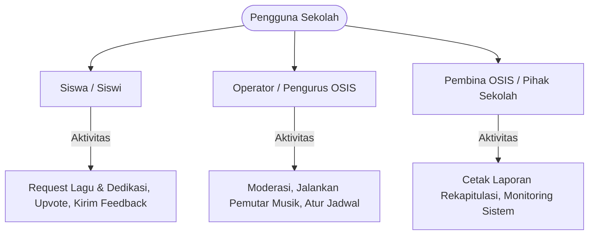
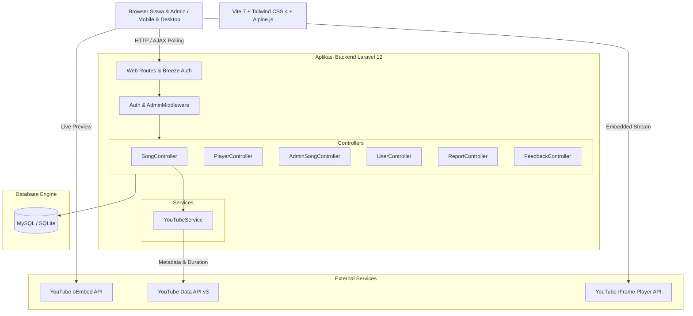
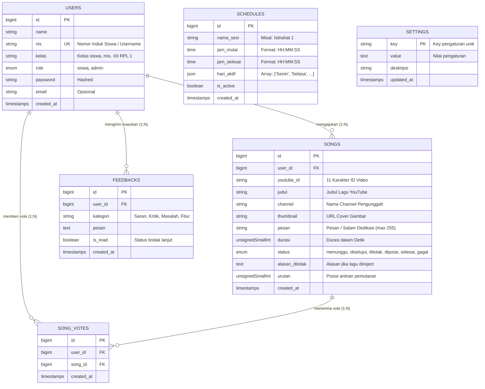
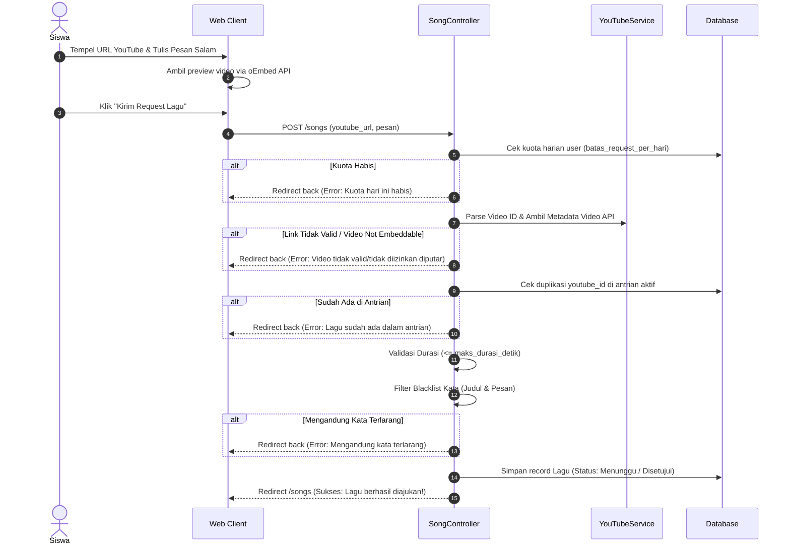
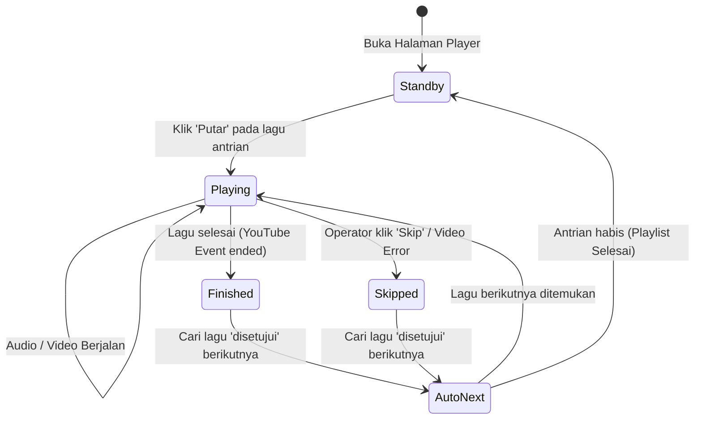

# PRODUCT REQUIREMENT DOCUMENT (PRD)
## **SELADA — Sistem Layanan Dedikasi dan Antrian Lagu**
*Platform Radio Request & Siaran Musik OSIS Sekolah Berbasis Web*

---

### **INFORMASI DOKUMEN**

| Atribut | Keterangan |
| :--- | :--- |
| **Nama Proyek** | SELADA (Sistem Layanan Dedikasi dan Antrian Lagu) |
| **Kategori / Domain** | Web Application / Edu-Tech & School Entertainment System |
| **Konteks Proyek** | Kompetisi Kejuruan USK 2026 (*Web Technologies*) |
| **Lead Developer** | Aliffansyah |
| **Versi Dokumen** | v1.0.0 |
| **Status Dokumen** | Final / Production Ready |
| **Framework & Stack** | Laravel 12 (PHP 8.2+), Tailwind CSS, Alpine.js, MySQL / SQLite, YouTube API |

---

## 1. PENDAHULUAN & LATAR BELAKANG

### 1.1 Latar Belakang Masalah
Pada lingkungan sekolah menengah (SMA/SMK), jam istirahat merupakan momen penting bagi siswa untuk menyegarkan pikiran. Organisasi Siswa Intra Sekolah (OSIS) biasanya mengelola siaran audio atau radio sekolah melalui speaker sentral. Namun, mekanisme konvensional request lagu menghadapi kendala:
1. **Pencatatan Manual**: Request lagu masih dicatat melalui kertas memo, grup WhatsApp, atau lisan, yang rentan hilang, tertumpuk, atau tidak teratur.
2. **Tidak Ada Moderasi Konten**: Sulit memfilter lagu yang mengandung lirik eksplisit, kata kasar, atau pesan/titipan salam yang melanggar norma tata tertib sekolah.
3. **Monopoli Request**: Tanpa sistem pembatasan kuota, beberapa siswa mendominasi pemutaran lagu sementara siswa lain tidak mendapatkan kesempatan.
4. **Kendala Teknis Pemutaran**: Operator OSIS harus mencari link satu per satu secara manual saat istirahat berlangsung, sering terjadi jeda hening (*dead air*), iklan video, atau link error.
5. **Transparansi Rendah**: Siswa tidak mengetahui status lagunya (apakah disetujui, ditolak, atau kapan akan diputar).

### 1.2 Solusi Produk: SELADA
**SELADA** adalah aplikasi web responsif terintegrasi yang mendigitalkan seluruh siklus pemutaran musik radio sekolah:
- **Bagi Siswa**: Mengajukan request lagu via URL YouTube dengan pratinjau instan (*oEmbed*), menitipkan salam dedikasi ke teman/guru, memberikan dukungan (*upvote*) pada lagu favorit di antrian, dan memantau status persetujuan secara transparan.
- **Bagi Operator OSIS / Admin**: Panel moderasi untuk menyetujui/menolak lagu (disertai alasan), mengatur urutan antrian, mengelola jadwal istirahat, serta pemutar lagu otomatis (*YouTube IFrame API*) yang berpindah lagu secara mulus tanpa intervensi manual.

### 1.3 Visi & Tujuan Produk
- **Menciptakan Suasana Sekolah yang Positif**: Menghadirkan hiburan yang sehat, terkontrol, dan membangkitkan semangat komunitas siswa.
- **Efisiensi Kerja OSIS**: Mengotomatisasi alur kerja DJ/operator siaran radio sekolah dari moderasi hingga pemutaran.
- **Akuntabilitas & Tata Tertib**: Menjaga siaran tetap bersih melalui filter kata terlarang (*blacklist*), pembatasan durasi, dan arsip laporan siaran resmi.

---

## 2. TARGET PENGGUNA & PERSONA



### 2.1 Persona 1: Siswa (End User)
- **Karakteristik**: Siswa aktif yang mengakses website mayoritas melalui ponsel pintar (*mobile device*) saat jam istirahat atau sebelum jam sekolah.
- **Kebutuhan**:
  - Login cepat tanpa repot mengetikkan email panjang (cukup menggunakan NIS dan Password).
  - Mengirim link lagu favorit dari YouTube/YouTube Music dengan cepat.
  - Menuliskan salam/pesan dedikasi singkat (maks. 255 karakter).
  - Memberikan *upvote* pada lagu yang dia sukai di antrian umum.
  - Mengetahui lagu apa yang sedang diputar di speaker sekolah saat ini (*Live ON AIR banner*).
  - Melaporkan keluhan atau memberi saran ke OSIS melalui profil akun.

### 2.2 Persona 2: Operator Siaran OSIS (Administrator)
- **Karakteristik**: Pengurus Seksi Bidang Apresiasi Seni/OSIS yang bertugas di ruang audio sekolah selama jam istirahat.
- **Kebutuhan**:
  - Dashboard monitoring antrian dan request yang butuh moderasi.
  - Pemutar video YouTube yang otomatis memutar lagu berikutnya tanpa harus mengklik manual setiap 3-4 menit.
  - Tombol aksi cepat: *Play, Skip, Next, Reorder Queue*.
  - Pemantauan kesesuaian waktu siaran dengan jam istirahat aktif sekolah.

### 2.3 Persona 3: Staf Tata Usaha / Pembina OSIS (Supervisor)
- **Kebutuhan**:
  - Import data siswa secara massal (*bulk import*) di awal tahun ajaran baru via file CSV atau copy-paste tabel excel.
  - Cetak laporan rekapitulasi lagu dan siswa teraktif untuk arsip pertanggungjawaban kegiatan ekstrakurikuler.

---

## 3. RUANG LINGKUP PRODUK (SCOPE)

### 3.1 Fitur yang Masuk Ruang Lingkup (In-Scope)
1. **Autentikasi Terpusat Berbasis NIS**: Login siswa & admin menggunakan Nomor Induk Siswa (bukan email). Tidak ada registrasi publik untuk menjaga integritas data sekolah.
2. **Pipeline Request Lagu YouTube Terverifikasi**:
   - Mendukung format URL: `youtube.com/watch`, `youtu.be`, `music.youtube.com`, `/shorts/`, `/embed/`.
   - Validasi ketersediaan embed (*IFrame embedding permission*).
   - Validasi batas durasi maksimal (default: 10 menit).
   - Validasi kuota request harian (default: 1 lagu/siswa/hari).
   - Filter otomatis kata-kata terlarang (*blacklist keywords*) pada judul dan pesan dedikasi.
   - Pengecekan lagu duplikat di antrian yang masih aktif.
3. **Sistem Antrian & Voting Interaktif**:
   - Halaman antrian dengan status *Live ON AIR*.
   - Live AJAX Polling (sinkronisasi data otomatis setiap 10 detik tanpa reload halaman).
   - Interaksi *Upvote/Like* berbasis AJAX (1 suara per siswa per lagu).
   - Tab "Request Saya" dengan rincian status (Menunggu, Disetujui, Ditolak + Catatan Alasan).
   - Tab "Top 5 Lagu Terpopuler" dan riwayat siaran.
4. **Mesin Pemutar Siaran Radio OSIS (`/admin/player`)**:
   - YouTube IFrame Player API terintegrasi penuh.
   - Auto-advance playlist (otomatis menandai lagu 'selesai' dan memutar lagu berikutnya).
   - Fallback otomatis bila terjadi video error (otomatis skip dalam 3 detik).
   - Penampil salam dedikasi dan identitas peminta lagu di layar pemutar.
   - Indikator sinkronisasi jadwal istirahat aktif.
5. **Panel Moderasi Lagu**:
   - Setujui (*Approve*) atau Tolak (*Reject*) disertai alasan yang dapat dibaca siswa.
   - Atur ulang urutan prioritas antrian (*Move Up / Move Down*).
   - Opsi mode moderasi otomatis (*Auto-approval bypass*).
6. **Kotak Kritik & Saran (Feedback Hub)**:
   - Form aspirasi di halaman profil siswa (Kategori: Saran, Kritik, Laporan Masalah, Permintaan Fitur).
   - Inbox admin dengan filter kategori dan status tindak lanjut (*Mark as Read/Unread*).
7. **Manajemen Pengguna & Bulk Import**:
   - Tambah/edit/hapus akun satuan.
   - **Bulk Import Siswa**: Mendukung upload file CSV atau *paste* data teks tab-separated langsung dari Microsoft Excel.
   - Fitur download template format CSV.
8. **Jadwal Siaran & Jam Istirahat**:
   - Konfigurasi sesi siaran (Jam mulai, Jam selesai, Pilihan hari aktif Senin-Jumat).
   - Logika deteksi otomatis sesi aktif *real-time*.
9. **Laporan & Cetak Rekapitulasi**:
   - Filter rentang tanggal dan status lagu.
   - Statistik total durasi siaran (menit) dan peringkat siswa teraktif.
   - Mode cetak ramah kertas (*Print View*) lengkap dengan Kop Surat OSIS resmi.

### 3.2 Di Luar Ruang Lingkup (Out-of-Scope)
- Streaming audio berbasis Icecast / Shoutcast mandiri (seluruh media bersumber dari YouTube IFrame).
- Upload file audio MP3/WAV lokal ke server lokal (untuk mencegah pelanggaran hak cipta dan penghematan storage server).
- Aplikasi native Android/iOS (fokus saat ini adalah Mobile-First Progressive Web Layout).

---

## 4. ARSITEKTUR TEKNOLOGI & SISTEM



### 4.1 Spesifikasi Perangkat Lunak
- **Server Language**: PHP 8.2 atau 8.3
- **Framework**: Laravel 12.x
- **Frontend Toolkit**: Tailwind CSS 3/4, Alpine.js 3.x, Axios 1.11+
- **Font**: Figtree (Google Fonts)
- **Database Engine**: 
  - Produksi: MySQL 8.0+
  - Development / Testing: SQLite 3
- **State & Session Store**: Database Session Driver (`sessions` table) & Database Cache Store

---

## 5. SKEMA & STRUKTUR BASIS DATA



### 5.1 Rincian Kamus Data Utama

#### 1. Tabel `users`
Menyimpan identitas akun siswa dan administrator.
- `nis`: Nomor Induk Siswa unik. Berfungsi sebagai kredensial login utama menggantikan sistem email.
- `role`: Mengatur hak akses tingkat aplikasi (`siswa` atau `admin`).

#### 2. Tabel `songs`
Inti dari operasional sistem lagu radio sekolah.
- `youtube_id`: Kode unik 11 karakter video YouTube.
- `durasi`: Durasi media dalam satuan detik murni untuk kalkulasi laporan agregat.
- `status`: State machine:
  - `menunggu`: Baru diajukan oleh siswa, menunggu moderasi admin.
  - `disetujui`: Lulus moderasi dan siap masuk antrian putar.
  - `diputar`: Sedang aktif dimainkan pada pemutar siaran radio.
  - `selesai`: Pemutaran lagu telah berakhir tuntas.
  - `ditolak`: Dibatalkan oleh admin disertai pengisian `alasan_ditolak`.
  - `gagal`: Terjadi kegagalan pemutaran (misal video dibatasi izin atau di-skip).

#### 3. Tabel `song_votes`
Tabel relasi pivot *Many-to-Many* antara `users` dan `songs`. Diberi aturan `UNIQUE(user_id, song_id)` sehingga satu pengguna hanya memiliki tepat 1 hak suara per lagu.

#### 4. Tabel `settings`
Tabel *Key-Value Store* dinamis:
- `batas_request_per_hari`: Nilai integer batasan kuota per siswa (default: 1).
- `maks_durasi_detik`: Nilai integer durasi video maksimal yang diizinkan (default: 600 detik / 10 menit).
- `blacklist_kata`: Kumpulan kata-kata terlarang dipisahkan tanda koma (*comma-separated*).
- `moderasi_otomatis`: String boolean ('1' = auto-approve, '0' = butuh persetujuan manual).

---

## 6. SPESIFIKASI KEBUTUHAN FUNGSIONAL

### 6.1 Modul 1: Autentikasi & Otorisasi
- **FR-AUTH-01 (Login Siswa & Admin)**: Pengguna dapat masuk menggunakan pasangan **NIS** dan **Kata Sandi**.
- **FR-AUTH-02 (Brute Force Protection)**: Pembatasan laju (*rate limiting*) maksimum 5 kali percobaan gagal sebelum akun terkunci sementara.
- **FR-AUTH-03 (Role-Based Redirection)**:
  - Jika `role == 'admin'`, sistem mengarahkan ke rute `/admin`.
  - Jika `role == 'siswa'`, sistem mengarahkan ke rute `/songs`.
- **FR-AUTH-04 (Role-Guarded Routes)**: Akses ke seluruh rute `/admin/*` diwajibkan melewati middleware `admin`. Pengguna non-admin yang mencoba mengakses akan dicegat HTTP 403 Forbidden.
- **FR-AUTH-05 (Closed Registration)**: Tidak ada pendaftaran publik mandiri. Akun hanya bisa dibuat oleh operator sekolah.

### 6.2 Modul 2: Request Lagu & Pesan Dedikasi


- **FR-REQ-01 (URL Parser Fleksibel)**: Sistem mampu mengekstraksi ID video dari ragam pola URL (YouTube standar, tautan pendek `youtu.be`, YouTube Music, maupun YouTube Shorts).
- **FR-REQ-02 (Live Client Preview)**: Form input dilengkapi tombol *paste from clipboard* dan menampilkan thumbnail, judul, dan nama channel secara langsung sebelum dikirimkan.
- **FR-REQ-03 (Pesan Salam Dedikasi)**: Siswa dapat melampirkan pesan dedikasi (maksimal 255 karakter) lengkap dengan indikator penghitung karakter waktu-nyata (*real-time counter*).
- **FR-REQ-04 (Validasi Kuota Harian)**: Sistem menolak pengajuan baru jika jumlah request siswa pada tanggal berjalan (`whereDate('created_at', today())`) sudah mencapai kuota setting.
- **FR-REQ-05 (Filter Konten Sensitif)**: Sistem membatalkan simpan jika judul lagu atau pesan dedikasi mengandung kata yang tercantum pada *Blacklist*.

### 6.3 Modul 3: Antrian Publik & Upvoting
- **FR-QUE-01 (Status Live ON AIR)**: Komponen dinamis yang menampilkan judul lagu, channel, dan peminta lagu yang statusnya `diputar` dengan animasi visual gelombang suara.
- **FR-QUE-02 (AJAX Live Polling)**: Tampilan daftar antrian secara otomatis memperbarui data setiap 10 detik tanpa perlu menyegarkan (*refresh*) seluruh halaman browser.
- **FR-QUE-03 (Mekanisme Upvote Interaktif)**: Siswa dapat menekan tombol vote (ikon jempol/api). Jika sudah pernah vote, klik kedua akan membatalkan vote (*toggle*). Total vote diperbarui secara asinkron tanpa reload.
- **FR-QUE-04 (Tab Request Saya)**: Siswa dapat melihat riwayat lagu yang pernah ia ajukan beserta statusnya:
  - Disertai badge warna status.
  - Menampilkan alasan penolakan jika status lagu `ditolak`.
- **FR-QUE-05 (Tangga Lagu Terpopuler)**: Menampilkan 5 lagu teratas yang paling sering diajukan dan diputar di sekolah.

### 6.4 Modul 4: Pemutar Siaran Musik Radio OSIS (`/admin/player`)


- **FR-PLY-01 (YouTube IFrame Engine)**: Player berjalan menggunakan antarmuka resmi YouTube IFrame Player API.
- **FR-PLY-02 (Auto-Next Playlist)**: Ketika event `YT.PlayerState.ENDED` tertangkap, client mengirimkan request AJAX ke `POST /admin/player/{song}/finish`. Sistem secara otomatis mengupdate status lagu lama menjadi `selesai` dan mengubah lagu urutan pertama berikutnya menjadi `diputar`.
- **FR-PLY-03 (Toleransi Error Siaran)**: Jika terjadi error pada video YouTube (kode error 100, 101, 150 - embedding disallowed), sistem otomatis menampilkan pemberitahuan dan melakukan skip ke lagu berikutnya dalam 3 detik untuk mencegah kekosongan siaran (*dead air*).
- **FR-PLY-04 (Penampil Salam Dedikasi)**: Layar pemutar menampilkan kartu identitas pemohon lagu beserta pesan salam yang dikirimkan agar operator/penyiar radio dapat membacakannya melalui mikrofon.
- **FR-PLY-05 (Indikator Jam Istirahat Aktif)**: Bilah informasi yang menampilkan apakah waktu saat ini berada dalam rentang sesi jadwal siaran yang aktif.

### 6.5 Modul 5: Moderasi Lagu & Antrian Admin
- **FR-MOD-01 (Approve & Reject)**: Admin dapat menyetujui lagu atau menolak pengajuan dengan mengisi catatan alasan penolakan (mis. "Lirik mengandung kata kasar", "Bukan genre yang diperbolehkan").
- **FR-MOD-02 (Reordering)**: Admin dapat menaikkan atau menurunkan posisi antrian lagu yang sudah disetujui (*Move Up / Move Down*) dengan menukar atribut `urutan`.
- **FR-MOD-03 (Skip Lagu)**: Admin dapat membatalkan pemutaran lagu di tengah jalan dan menandainya dengan status `gagal`.

### 6.6 Modul 6: Manajemen Pengguna & Bulk Import
- **FR-USR-01 (CRUD Satuan)**: Tambah, ubah, reset password, dan hapus akun pengguna. Akun admin sendiri dicegah untuk dihapus oleh dirinya sendiri.
- **FR-USR-02 (Bulk Import CSV)**: Upload file `.csv` dengan header: `nis,nama,kelas,password`.
- **FR-USR-03 (Bulk Import Copy-Paste)**: Admin dapat menempelkan langsung teks berformat tab-separated dari aplikasi spreadsheet (Excel/Google Sheets).
- **FR-USR-04 (Deduplikasi Data Massal)**: Sistem secara cerdas mengabaikan NIS yang sudah terdaftar di database tanpa membatalkan seluruh baris baru, serta memberikan notifikasi daftar NIS mana saja yang dilewati.
- **FR-USR-05 (Download Template)**: Tombol unduh file contoh CSV yang siap diisi.

### 6.7 Modul 7: Jadwal Siaran Sekolah
- **FR-SCH-01 (Konfigurasi Sesi)**: Pengaturan nama sesi (mis. "Istirahat Pagi", "Istirahat Siang"), jam mulai, jam selesai, dan hari-hari aktif.
- **FR-SCH-02 (Real-time Checker)**: Fungsi `isNowActive()` yang mengevaluasi hari dalam Bahasa Indonesia dan jam saat ini dengan toleransi detik.

### 6.8 Modul 8: Kotak Masukan & Aspirasi (Feedback)
- **FR-FDB-01 (Pengiriman Siswa)**: Siswa dapat mengirimkan masukan dari halaman profil dengan memilih kategori (*Saran, Kritik, Laporan Masalah, Permintaan Fitur*).
- **FR-FDB-02 (Tindak Lanjut Admin)**: Admin dapat memfilter masukan berdasarkan kategori atau status baca, serta menandai masukan sebagai sudah/belum dibaca (*Toggle Read*).

### 6.9 Modul 9: Laporan & Cetak Rekapitulasi
- **FR-REP-01 (Filter Periode & Status)**: Penyaringan rekaman lagu berdasarkan rentang tanggal mulai-selesai dan status lagu.
- **FR-REP-02 (Statistik Agregat)**: Menghitung total request, lagu selesai diputar, lagu ditolak, akumulasi durasi siaran dalam satuan menit, serta daftar 5 siswa paling aktif.
- **FR-REP-03 (Cetak Berita Acara)**: Tampilan ramah cetak (*print-optimized view*) dengan kop surat resmi OSIS sekolah, tanda tangan pengesahan Ketua OSIS dan Pembina.

---

## 7. KEBUTUHAN NON-FUNGSIONAL (NFR)

### 7.1 Kinerja (Performance)
- **Waktu Respons Web**: Waktu respon halaman (*Time to First Byte*) rata-rata di bawah 300 ms pada lingkungan server lokal/intranet.
- **Optimasi Kuota Request**: Live polling antrian menggunakan endpoint respons parsial Blade (`_antrian_list.blade.php`) untuk meminimalkan beban transfer data jaringan.
- **Eager Loading Relasi**: Semua pemanggilan Eloquent pada antrian lagu mengikutsertakan relasi `user` dan `votes` (`with(['user', 'votes'])`) untuk mengeliminasi kendala *N+1 query problem*.

### 7.2 Keamanan (Security)
- **Proteksi CSRF**: Seluruh pengiriman formulir dan AJAX request menyertakan token CSRF (`X-CSRF-TOKEN`).
- **Sanitasi Konten**: Perlindungan terhadap XSS (*Cross-Site Scripting*) memanfaatkan auto-escaping mesin template Blade `{{ ... }}`.
- **Enkripsi Sandi**: Penyimpanan kata sandi akun menggunakan algoritma hashing standar industri `bcrypt` dengan cost factor 12.
- **Injeksi SQL**: Pencegahan injeksi SQL melalui PDO Prepared Statements pada Laravel Eloquent ORM.

### 7.3 Ketersediaan & Keandalan (Reliability)
- **Graceful Fallback API**: Jika kuota YouTube Data API v3 habis atau API Key tidak dikonfigurasi, sistem tidak akan *crash*, melainkan beralih menggunakan thumbnail standar `img.youtube.com/vi/{id}/mqdefault.jpg` dan judul bawaan.
- **Auto-Recovery Siaran**: Jika sambungan video gagal di tengah siaran, pemutar radio otomatis beralih ke lagu berikutnya setelah 3 detik.

### 7.4 Kompatibilitas & Aksesibilitas (Usability & Responsiveness)
- **Mobile First**: Desain halaman siswa dioptimalkan untuk perangkat layar sentuh smartphone (*floating action button*, tap-target minimal 44x44px).
- **Cross-Browser**: Kompatibel dengan peramban modern utama (Google Chrome, Mozilla Firefox, Safari, Microsoft Edge).

---

## 8. STRUKTUR MENU & PETA SITUS (SITEMAP)

```
SELADA Web Portal
│
├── 🔑 Autentikasi
│   ├── Login Akun (/login)
│   └── Logout (/logout)
│
├── 🎓 Portal Siswa (Siswa & Admin)
│   ├── Antrian Lagu & Siaran (/songs)
│   │   ├── Tab Antrian Aktif (Live Polling)
│   │   ├── Tab Request Saya
│   │   ├── Tab Top 5 Terpopuler
│   │   └── Tab Riwayat Siaran
│   ├── Form Request Lagu (/songs/create)
│   └── Profil Siswa (/profile)
│       ├── Edit Biodata
│       ├── Ganti Password
│       └── Form Kirim Kritik & Saran OSIS
│
└── 🛠️ Panel Administrator / Operator OSIS (/admin)
    ├── Dashboard Ringkasan (/admin)
    ├── Pemutar Radio Siaran (/admin/player)
    ├── Moderasi Antrian Lagu (/admin/songs)
    ├── Kotak Kritik & Saran Siswa (/admin/feedbacks)
    ├── Manajemen Jadwal Istirahat (/admin/schedules)
    ├── Laporan & Cetak Arsip (/admin/reports & /admin/reports/print)
    ├── Manajemen Akun Pengguna (/admin/users)
    │   ├── Tambah Satuan
    │   ├── Bulk Import (CSV & Paste Excel)
    │   └── Download Template CSV
    └── Pengaturan Global Sistem (/admin/settings)
```

---

## 9. ATURAN BISNIS SISTEM (BUSINESS RULES)

| Kode Aturan | Nama Aturan | Logika Bisnis & Penjelasan |
| :--- | :--- | :--- |
| **BR-01** | Batasan Kuota Request | Siswa hanya dapat mengajukan sejumlah request tertentu per hari (standar: 1 lagu). Request baru akan ditolak sebelum hari kalender berganti. |
| **BR-02** | Larangan Lagu Duplikat | Lagu dengan `youtube_id` yang sama dilarang diajukan jika saat ini masih berstatus `menunggu`, `disetujui`, atau `diputar`. Jika sudah `selesai` atau `ditolak`, lagu boleh diajukan kembali. |
| **BR-03** | Pembatasan Durasi Lagu | Video YouTube dengan durasi melebihi batas (default: 600 detik / 10 menit) akan ditolak saat validasi untuk mencegah satu lagu mendominasi jam istirahat. |
| **BR-04** | Kebijakan Kata Terlarang | Jika judul lagu atau pesan dedikasi mengandung salah satu kata dalam daftar hitam (*blacklist*), sistem menggagalkan penyimpanan dan memberi notifikasi pelanggaran kebijakan sekolah. |
| **BR-05** | Hak Suara Upvote Tunggal | Satu siswa hanya dapat memberikan tepat 1 upvote untuk setiap lagu. Upvote dapat dibatalkan kembali (*toggle*). |
| **BR-06** | Hak Hapus Akun Mandiri | Siswa dilarang menghapus akunnya sendiri (fitur *Delete Account* bawaan Breeze dinonaktifkan dan diganti menjadi Kotak Aspirasi) demi menjaga integritas data sekolah. |
| **BR-07** | Integritas Akun Admin | Akun admin yang sedang aktif masuk sistem dicegah untuk menghapus akunnya sendiri guna menghindari terkuncinya akses sistem. |

---

## 10. METRIK PENGUJIAN & KRITERIA PENERIMAAN (TEST MATRIX)

Aplikasi telah divalidasi dengan rangkaian automated test (**24 Feature & Unit Tests, 73 Assertions Passed**):

| Modul Uji | Skenario yang Diuji | Status |
| :--- | :--- | :---: |
| **AuthenticationTest** | Login dengan NIS valid, penolakan password salah, proteksi rate limiting | ✅ Passed |
| **SongRequestTest** | Alur request lagu sukses, validasi kuota harian, penolakan durasi lebih, penolakan duplikat antrian | ✅ Passed |
| **AdminModerationTest** | Approval lagu, rejection lagu disertai alasan, pengurutan antrian (*move-up/down*), otorisasi non-admin | ✅ Passed |
| **PlayerTest** | Perubahan state 'diputar', auto-next saat lagu selesai diputar, skip lagu dengan penanda status gagal | ✅ Passed |
| **SongVoteAndFeedbackTest** | Toggle upvote, pencatatan vote tunggal, pengiriman kritik/saran dari profil | ✅ Passed |
| **ReportAndScheduleTest** | Filter laporan siaran, kalkulasi agregat durasi menit, verifikasi logika aktif jam sesi istirahat | ✅ Passed |

---

## 11. ROADMAP & RENCANA PENGEMBANGAN LANJUTAN

### Tahap 1: Stabilisasi & Lomba USK 2026 (Status Saat Ini)
- [x] Sistem autentikasi NIS terintegrasi.
- [x] Mesin request lagu dengan validasi YouTube API.
- [x] Antrian interaktif dengan polling AJAX dan voting.
- [x] Pemutar IFrame otomatis dengan fitur auto-next.
- [x] Panel administrasi lengkap: moderasi, user bulk import, jadwal, setting, dan cetak laporan.

### Tahap 2: Peningkatan Interaktivitas (Versi 1.1)
- [ ] Implementasi WebSockets / Laravel Reverb untuk pengganti polling AJAX agar komunikasi status siaran berjalan *real-time true push*.
- [ ] Integrasi text-to-speech otomatis untuk membacakan pesan dedikasi siswa sebelum lagu dimulai.
- [ ] Fitur preview cuplikan audio 30 detik langsung di browser siswa.

### Tahap 3: Ekosistem Sekolah Terpadu (Versi 2.0)
- [ ] Mode TV Kiosk Display untuk monitor kantin / koridor sekolah yang menampilkan *Now Playing & Up Next*.
- [ ] Sinkronisasi database siswa langsung dengan Dapodik / API SIM Sekolah.

